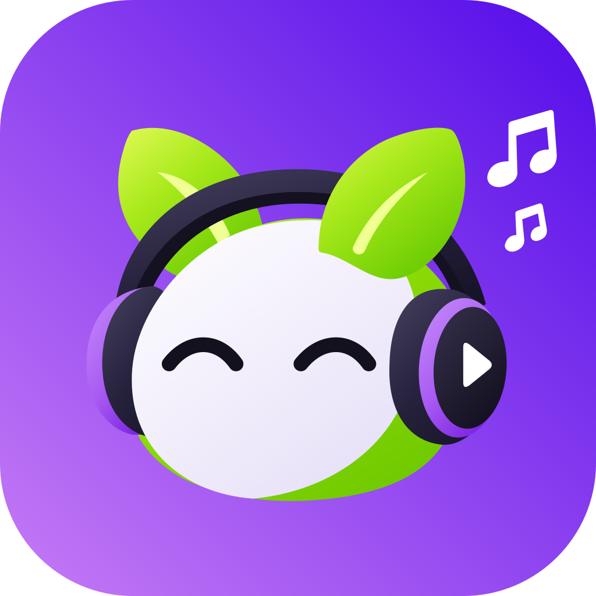
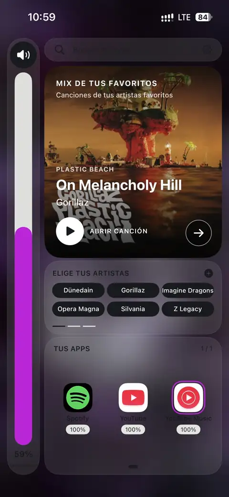
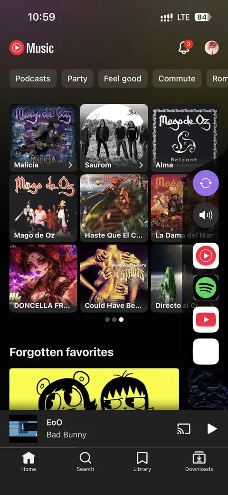
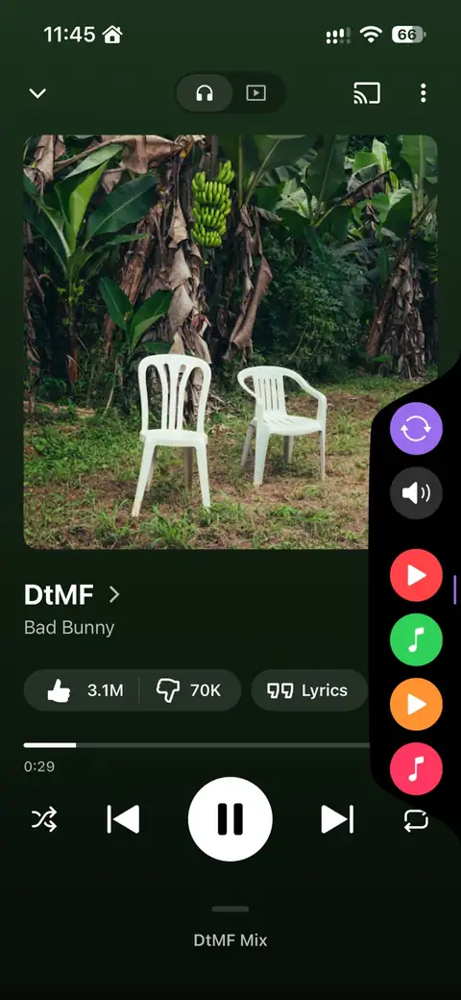
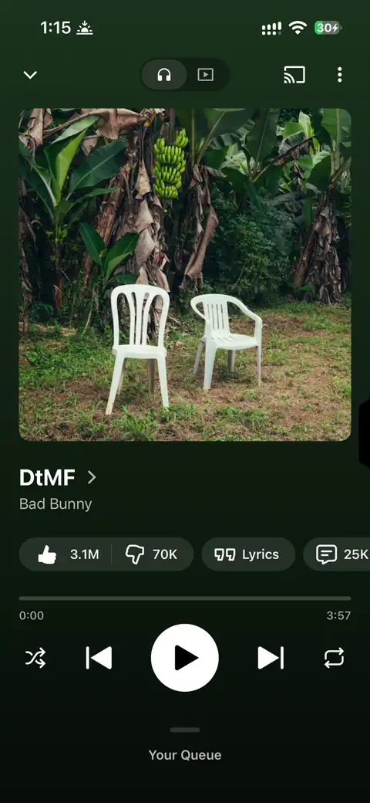
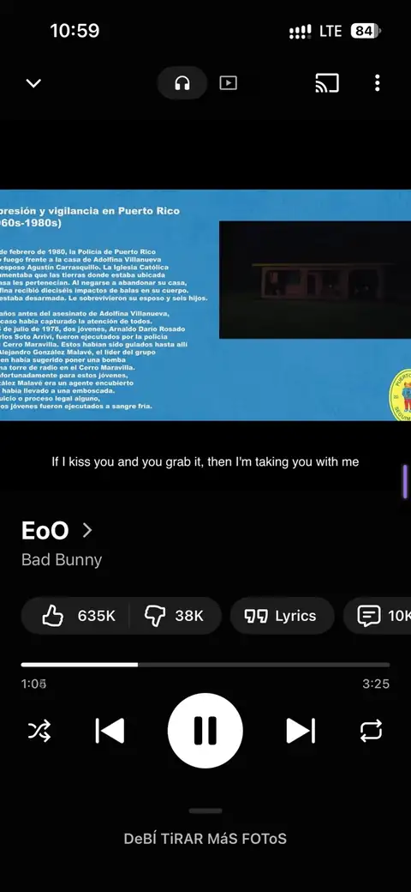
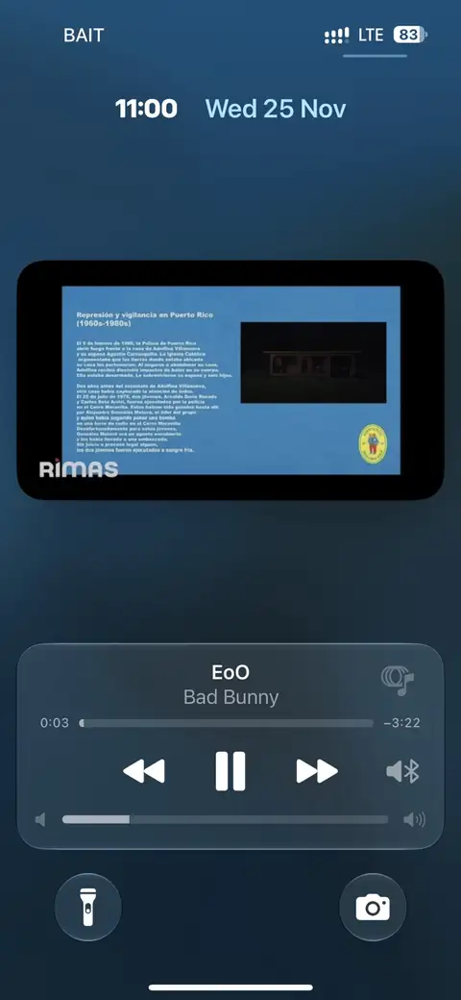

  

<h1 align="center">MediaBloom</h1>

A standalone multimedia launcher for iOS, built on the shared LiveContainer runtime.

  

  <a href="https://github.com/AdriFOG/MediaBloom-iOS/releases/download/v2.4.0/MediaBloom-SideStore-unsigned.ipa"><strong>Download IPA</strong></a> ·
  <a href="https://github.com/AdriFOG/MediaBloom-iOS/releases/tag/v2.4.0">Release notes</a>

## Capturas reales / Screenshots 📱

<em>Así se ve MediaBloom en un iPhone · MediaBloom running on a real iPhone</em>

<table>
  <tr>
    <td align="center" width="33%">
      
       <strong>Inicio / Home</strong>
    </td>
    <td align="center" width="33%">
      
       <strong>Edge: accesos / Shortcuts</strong>
    </td>
    <td align="center" width="33%">
      
       <strong>Edge: controles / Controls</strong>
    </td>
  </tr>
  <tr>
    <td align="center">
      
       <strong>Edge compacto / Collapsed</strong>
    </td>
    <td align="center">
      
       <strong>Reproducción / Playback</strong>
    </td>
    <td align="center">
      
       <strong>Pantalla bloqueada / Lock Screen</strong>
    </td>
  </tr>
</table>

Toca una imagen para verla completa · Tap a screenshot to open it. Fotos reales del proyecto, optimizadas para carga rápida / Real screenshots, optimized for fast loading.

## MediaBloom 2.4 — What's New / Novedades

**Español:** MediaBloom Edge estrena una muesca flotante con animación gelatinosa, menú de volumen individual y hasta **4 aplicaciones personalizables**. Music Haptics incluye mejoras de búsqueda y sincronización, con un indicador de progreso que desaparece al terminar y puede ocultarse deslizando. El launcher ahora permite elegir aplicaciones compartidas de BloomBox, y crear accesos directos al inicio del iPhone mediante **perfiles WebClip**, usando el enlace exclusivo `bloomboxmedia://`.

**English:** MediaBloom 2.4 adds the elastic **Edge** quick launcher with up to four ordered shortcuts and app-specific volume controls. **Music Haptics** gains faster lookup, resync and temporary swipe-away progress. Choose shared BloomBox apps for the MediaBloom home and generate iPhone Home Screen **WebClip profiles** that always target `bloomboxmedia://`.

Only **shared and unlocked** apps are available to MediaBloom. An iOS configuration profile needs to be installed through Settings for each Home Screen WebClip. Apps and data are not copied from BloomBox. MediaBloom remains a separate **multimedia-only** host; Music Haptics compatibility varies by song and app.

## Meet Bloom 🎧

MediaBloom's new app icon features Bloom wearing headphones, with ten vector layers and native light, dark, tinted and Liquid Glass appearances on supported iOS versions. Older versions use compatible icon fallbacks. The [original icon source](assets/AppIcon.icon) is included in this repository.

## Standalone build

The signed-ready (unsigned) IPA is published in **Releases**, and Actions also produces experimental artifacts named
**MediaBloom-SideStore-unsigned.ipa**. It is intended to be signed with SideStore
or a compatible installer before installation. The current stable release is **v2.4.0 — Edge + Music Haptics + WebClips**.

- Standalone host ID: `com.kdt.BloomBoxMedia`
- Standalone launch URL: `bloomboxmedia://`
- Name on iPhone: **BloomBox Media**
- Shares LiveContainer apps and data only through the signed App Group, when
  the two independently installed hosts have compatible signing identities.
- Shows recognized **shared** media apps such as YouTube, YouTube Music, Spotify,
  VLC and other supported multimedia clients.
- Does **not** provide a gaming launcher. Games are blocked from the media host.
- **BloomAudio** volume (YouTube/YouTube Music) includes optional live controls inside apps; verified on iPhone in v0.3.

## Safety / never overwrite your working BloomBox

1. Install only `MediaBloom-SideStore-unsigned.ipa` produced by **this repository**.
2. Do **not** install a BloomBox primary IPA just to obtain the Media edition.
3. The build verifies its bundle ID is different from BloomBox and checks its
   distinct URL scheme and embedded extension identifiers before publishing an artifact.
4. Do not delete or reinstall BloomBox. The Media edition is a separate iOS app.
5. After installing, convert selected media guests to **Shared App** in the
   primary BloomBox instance, then reopen Media.

The initial builder pins a known experimental BloomBox engine commit. MediaBloom
maintains its own brand, metadata, UI routing and build verification; it does not
modify BloomBox's main branch. Native device compatibility is still being tested.

Source licenses: AGPL-3.0 and original upstream copyright notices are retained.
Additional original BloomBox terms are in the source snapshot's
`LICENSE-ADDITIONAL-TERMS.md`.
